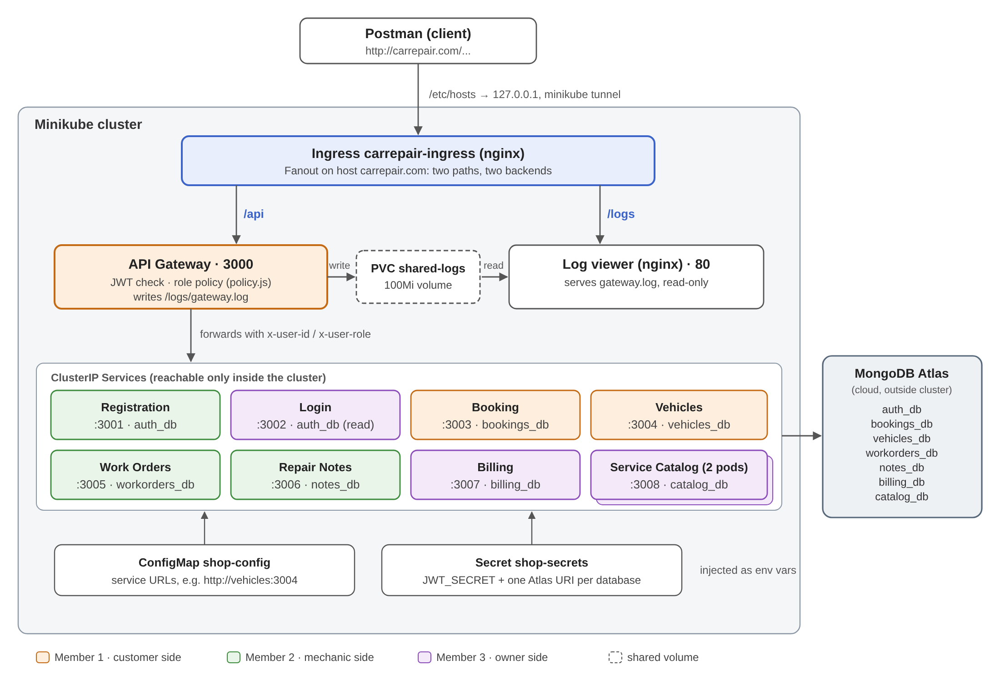

# Car Repair Shop Management System (CLD 376)

The backend for a car repair shop. Customers register their cars, book repairs, follow the repair's progress and see what they owe. Mechanics see the jobs assigned to them and write notes on what they found and fixed. The manager (shop owner) controls everything: approves bookings, assigns mechanics, sets prices and bills customers.

- **Backend only:** you use it through an API, for example with Postman. There is no website or app.
- **9 microservices** written in Node.js (Express 5, Mongoose 8), each in its own Docker container.
- **Kubernetes on Minikube**, defined in YAML only. One Ingress on `carrepair.com` is the way in, and the API Gateway is the only way to reach the services.
- **MongoDB Atlas**, a cloud database, with a separate database for each service.
- **JWT login** with 3 roles: customer, mechanic and manager.

This repo holds both CLD 376 submissions. The **final project** (Kubernetes) is what the repo runs today. The **midterm** (Docker on 3 AWS EC2 instances) is kept as the git tag `midterm`; see [Project history](#project-history).

## Contents

1. [Architecture](#architecture)
2. [Roles and permissions](#roles-and-permissions)
3. [How one request works](#how-one-request-works)
4. [The repair flow](#the-repair-flow)
5. [API endpoints](#api-endpoints)
6. [Security](#security)
7. [Load balancer](#load-balancer)
8. [Data design](#data-design)
9. [Deploy on Kubernetes](#deploy-on-kubernetes)
10. [Fanout and shared volume](#fanout-and-shared-volume)
11. [Run it with Docker Compose](#run-it-with-docker-compose)
12. [Testing with Postman](#testing-with-postman)
13. [Project structure](#project-structure)
14. [Conventions](#conventions)
15. [Known limitations](#known-limitations)
16. [Team](#team)
17. [Project history](#project-history)
18. [AI usage](#ai-usage)

## Architecture



Postman calls `http://carrepair.com`. The Ingress sends `/api` to the API Gateway and `/logs` to a read-only log viewer. The gateway checks the login token and the role, then forwards the request to the right service by its Kubernetes name. Each service talks only to its own database on MongoDB Atlas.

| Service | Owner | Port | Address inside the cluster | Path through the gateway | Database |
| --- | --- | --- | --- | --- | --- |
| api-gateway | Member 1 | 3000 | `http://api-gateway:3000` | entry point for everything | none |
| registration | Member 2 | 3001 | `http://registration:3001` | `/api/auth/register`, `/api/users` | `auth_db` |
| login | Member 3 | 3002 | `http://login:3002` | `/api/auth/login`, `/api/auth/me`, `/api/auth/verify` | `auth_db` (read only) |
| booking | Member 1 | 3003 | `http://booking:3003` | `/api/bookings` | `bookings_db` |
| vehicles | Member 1 | 3004 | `http://vehicles:3004` | `/api/vehicles` | `vehicles_db` |
| work-orders | Member 2 | 3005 | `http://work-orders:3005` | `/api/work-orders` | `workorders_db` |
| repair-notes | Member 2 | 3006 | `http://repair-notes:3006` | `/api/notes` | `notes_db` |
| billing | Member 3 | 3007 | `http://billing:3007` | `/api/invoices` | `billing_db` |
| service-catalog (2 pods) | Member 3 | 3008 | `http://service-catalog:3008` | `/api/catalog` | `catalog_db` |
| log-viewer (nginx) | Member 3 | 80 | `http://log-viewer:80` | `carrepair.com/logs/` (not through the gateway) | reads the shared volume |

Every Kubernetes Service is `ClusterIP`, so it can only be reached from inside the cluster. The only way in from outside is the Ingress, which points at the gateway and the log viewer, so nobody can go around the gateway.

## Roles and permissions

| Role | Who | How the account is made |
| --- | --- | --- |
| Customer | A car owner | Signs up themselves with `POST /api/auth/register` |
| Mechanic | Shop staff | Created by a manager |
| Manager | The shop owner | The first one comes from the seed script; others are created by a manager |

| What | Customer | Mechanic | Manager |
| --- | --- | --- | --- |
| Users | Sign up, see own profile | See own profile | Create staff, list users |
| Vehicles | Full control of own cars | Read all | Read, update, delete |
| Service Catalog | Read (no login needed) | Read | Full control |
| Bookings | Create, read and cancel own (while pending) | None | Read all, approve or reject, delete |
| Work Orders | Read own (to follow the repair) | Read assigned ones, update status | Full control; create and assign |
| Repair Notes | None | Add notes; edit and delete own | Read, delete |
| Invoices | Read own | None | Full control; create, mark paid |

Every request is checked twice:

1. **The gateway checks the role:** "can a customer ever do this?"
2. **The service checks the owner:** "is this your car, your booking, your invoice?"

The gateway can't do the second check, because it doesn't know who owns which record. A failed owner check returns 403. List endpoints don't fail: they quietly show only your own records.

## How one request works

1. Postman sends the request to `http://carrepair.com/api/...` with `Authorization: Bearer <token>`. The Ingress passes everything under `/api` to the gateway.
2. The gateway checks that the token is real and not expired. If not, it returns **401**.
3. The gateway looks up the method and path in `policy.js`. If the role isn't allowed, or the route isn't listed at all, it returns **403**.
4. The gateway removes any `x-user-id` and `x-user-role` headers the client sent, sets them again from the token, and forwards the request.
5. The service reads those two headers, checks ownership, and reads or writes its own database. The answer goes back through the gateway unchanged.

## The repair flow

One repair uses all 9 services. This is also the demo order.

1. A customer registers, logs in and gets a token.
2. The customer looks at the price list (no login needed) and adds their car.
3. The customer books a repair. Booking asks Vehicles to confirm the car is really theirs.
4. The manager approves the booking.
5. The manager turns the booking into a work order and assigns a mechanic. Work Orders reads the booking and copies the customer and car.
6. The mechanic sets the work order to `in_progress` and adds a "finding" note.
7. The mechanic adds a "work done" note and sets the work order to `completed`.
8. The customer checks the work order to see that the repair is done.
9. The manager creates the invoice. Billing confirms the work order is completed, and the server adds up the total.
10. The customer sees the invoice, and the manager marks it paid.

## API endpoints

All paths go through the gateway (`http://carrepair.com` on Kubernetes, `http://localhost:3000` with Docker Compose). **Public** means no token is needed. "Own" and "assigned" are checked by the service.

### Registration (port 3001)

| Method | Path | Who | Notes |
| --- | --- | --- | --- |
| POST | `/api/auth/register` | Public | Always creates a customer, whatever `role` the body says |
| POST | `/api/users/staff` | Manager | Creates a mechanic or manager |
| GET | `/api/users` | Manager | `?role=mechanic` lists mechanics to assign |

### Login (port 3002)

| Method | Path | Who | Notes |
| --- | --- | --- | --- |
| POST | `/api/auth/login` | Public | Returns `{ token, expiresIn, user }` |
| GET | `/api/auth/me` | Any role | Your own profile |
| GET | `/api/auth/verify` | Any role | Shows what's inside your token |

### Vehicles (port 3004)

| Method | Path | Who | Notes |
| --- | --- | --- | --- |
| POST | `/api/vehicles` | Customer | The owner is always the logged-in customer |
| GET | `/api/vehicles` | All roles | Customers see only their own cars |
| GET | `/api/vehicles/:id` | Own customer, mechanic, manager | |
| PUT | `/api/vehicles/:id` | Own customer, manager | Any field except the owner |
| DELETE | `/api/vehicles/:id` | Own customer, manager | |

### Booking (port 3003)

| Method | Path | Who | Notes |
| --- | --- | --- | --- |
| POST | `/api/bookings` | Customer | Checks the car is yours; the date must be in the future |
| GET | `/api/bookings` | Customer, manager | Customers see their own; managers can add `?status=pending` |
| GET | `/api/bookings/:id` | Own customer, manager | |
| PATCH | `/api/bookings/:id/status` | Own customer, manager | Only while pending. Customer: `cancelled`. Manager: `approved` or `rejected` |
| DELETE | `/api/bookings/:id` | Manager | |

### Work Orders (port 3005)

| Method | Path | Who | Notes |
| --- | --- | --- | --- |
| POST | `/api/work-orders` | Manager | Body: `bookingId`, `mechanicId`. The booking must be approved |
| GET | `/api/work-orders` | All roles | Customers see theirs, mechanics see the ones assigned to them |
| GET | `/api/work-orders/:id` | Own customer, assigned mechanic, manager | |
| PATCH | `/api/work-orders/:id/status` | Assigned mechanic, manager | `assigned`, `in_progress` or `completed` |
| DELETE | `/api/work-orders/:id` | Manager | |

### Repair Notes (port 3006)

| Method | Path | Who | Notes |
| --- | --- | --- | --- |
| POST | `/api/notes` | Mechanic | Body: `workOrderId`, `type` (`finding` or `work_done`), `text` |
| GET | `/api/notes?workOrderId=` | Mechanic, manager | `workOrderId` is required |
| GET | `/api/notes/:id` | Mechanic, manager | |
| PUT | `/api/notes/:id` | The note's author | Only `type` and `text` can change |
| DELETE | `/api/notes/:id` | The note's author, manager | |

### Billing (port 3007)

| Method | Path | Who | Notes |
| --- | --- | --- | --- |
| POST | `/api/invoices` | Manager | Body: `workOrderId`, `lineItems`. The work order must be completed; the server works out the total |
| GET | `/api/invoices` | Customer, manager | Customers see their own; managers can add `?status=unpaid` |
| GET | `/api/invoices/:id` | Own customer, manager | |
| PATCH | `/api/invoices/:id/pay` | Manager | Body: `paymentMethod` (`cash`, `bank_transfer` or `card`) |
| DELETE | `/api/invoices/:id` | Manager | Only while unpaid |

### Service Catalog (port 3008, 2 copies)

| Method | Path | Who | Notes |
| --- | --- | --- | --- |
| GET | `/api/catalog` | Public | The price list; `?active=true` hides inactive services |
| GET | `/api/catalog/:id` | Public | |
| POST | `/api/catalog` | Manager | |
| PUT | `/api/catalog/:id` | Manager | |
| DELETE | `/api/catalog/:id` | Manager | |
| GET | `/api/catalog/health` | Public | Shows which copy answered (for the load balancer demo) |

Every service also has `GET /health`, which Docker (health check) and Kubernetes (readiness and liveness probes) use to tell whether the container is healthy.

## Security

- **Login tokens (JWT):** Login signs a token with HS256 that lasts 1 hour and holds the user's id, role and name. Only the gateway checks tokens. The algorithm is fixed, so a forged "unsigned" token is rejected.
- **Deny by default:** every endpoint must have a row in `services/api-gateway/src/policy.js`. Anything not listed is blocked with 403, so a forgotten row closes access instead of opening it.
- **No fake identities:** the gateway always deletes `x-user-id` and `x-user-role` sent by the client before setting them from the token.
- **Ownership checks:** services take the owner from the headers, never from the request body. A customer can't sign up as a manager, put someone else's id on a car, or set an invoice total.
- **Passwords:** hashed with bcrypt (cost 10) and never returned in any response.
- **One login error:** a wrong email and a wrong password both give "Invalid email or password", so nobody can find out which emails are registered.
- **No direct access:** every Kubernetes Service is `ClusterIP`; the Ingress only points at the gateway and the log viewer.
- **Secrets stay out of git:** on Kubernetes, `JWT_SECRET` and the Atlas URIs live in the Secret `shop-secrets`. Only `k8s/config/secret.example.yaml` with placeholders is committed; the real `secret.yaml` and all `.env` files are gitignored.

## Load balancer

The Service Catalog runs as 2 pods behind one Kubernetes Service. Both use the same database. The gateway sends every catalog request to the Service, and Kubernetes spreads them across the pods. The gateway opens a fresh connection for each catalog request (keep-alive off), otherwise Node would reuse one connection and every request would land on the same pod.

To see it, send `GET /api/catalog/health` several times. The `instance` field shows the name of the pod that answered.

(In the midterm on EC2, the gateway did this itself with round-robin code. That code was removed for the final.)

## Data design

- **One database per service.** Services never read each other's data directly; they ask each other through the API. A change in one service's data can't silently break another.
- **Copied ids.** Some records copy an id when they are created: `customerId` and `vehicleId` on work orders, and `customerId` on invoices. That way each service can show "only your records" without calling another service.
- **Only 3 calls between services, all through the gateway with the caller's own token:**
  - Booking → Vehicles: is it your car?
  - Work Orders → Booking: is it approved?
  - Billing → Work Orders: is it completed?

  Each call waits up to 5 seconds, then fails with 502.
- **Unique indexes** stop duplicates even when two requests arrive at the same moment: one email per user, one plate per car, one catalog name, one work order per booking, and one invoice per work order.
- **Money is whole cents** (`2500` = $25.00), so totals never drift by fractions of a cent.

### CRUD coverage

| Database | Create | Read | Update | Delete |
| --- | --- | --- | --- | --- |
| vehicles | ✓ | ✓ | ✓ | ✓ |
| bookings | ✓ | ✓ | ✓ (status) | ✓ |
| work orders | ✓ | ✓ | ✓ (status) | ✓ |
| repair notes | ✓ | ✓ | ✓ | ✓ |
| invoices | ✓ | ✓ | ✓ (mark paid) | ✓ |
| catalog | ✓ | ✓ | ✓ | ✓ |
| users | ✓ | ✓ | – | – |

All six domain services have full create, read, update and delete. User accounts belong to the two login services: Registration creates them and Login only reads them. User update and delete were left out on purpose. Deleting an account would leave its bookings, work orders and invoices pointing at a user that no longer exists. A real system would deactivate accounts instead.

## Deploy on Kubernetes

The cluster is Minikube on one laptop, with the Docker driver. Every object is a YAML file in `k8s/`, applied with `kubectl apply -f`. [k8s/README.md](k8s/README.md) lists the names all the YAML files share.

You need Docker Desktop, Minikube, kubectl and the team's Atlas details. The test data from the seed scripts (see [Run it with Docker Compose](#run-it-with-docker-compose), step 3) lives in Atlas, so it only has to be added once.

**Windows (PowerShell)**, the setup used for the demo:

```powershell
# 1. Cluster
minikube start --driver=docker
minikube addons enable ingress

# 2. Build the images inside Minikube's Docker (the YAML uses imagePullPolicy: Never)
& minikube -p minikube docker-env --shell powershell | Invoke-Expression
$services = "api-gateway","registration","login","booking","vehicles","work-orders","repair-notes","billing","service-catalog"
foreach ($s in $services) { docker build -t "shop-${s}:v2" "services/$s" }

# 3. Configuration and storage
Copy-Item k8s/config/secret.example.yaml k8s/config/secret.yaml   # then fill in the real values
kubectl apply -f k8s/config/configmap.yaml -f k8s/config/secret.yaml
kubectl apply -f k8s/storage/pvc.yaml
kubectl apply -f k8s/storage/permissions-job.yaml
kubectl wait --for=condition=complete job/fix-log-permissions --timeout=120s

# 4. Services, log viewer, Ingress
foreach ($d in $services + "log-viewer") { kubectl apply -f "k8s/$d" }
kubectl apply -f k8s/ingress
kubectl get pods            # wait until everything is Running and 1/1 READY

# 5. Domain and tunnel
# As administrator, add this line to C:\Windows\System32\drivers\etc\hosts:
#   127.0.0.1 carrepair.com
minikube tunnel             # leave running in its own terminal
```

**macOS / Linux (bash):** the same steps; only three commands differ.

```bash
eval $(minikube docker-env)
for s in api-gateway registration login booking vehicles work-orders repair-notes billing service-catalog; do
  docker build -t shop-$s:v2 services/$s
done
echo "127.0.0.1 carrepair.com" | sudo tee -a /etc/hosts
```

Check it works: `http://carrepair.com/api/catalog` should return the price list, and `http://carrepair.com/logs/` should list `gateway.log`.

To look around: `minikube dashboard`, `kubectl get pods,svc,ingress,pvc`.

## Fanout and shared volume

**Fanout.** The Ingress `carrepair-ingress` serves one domain and sends each path to a different backend:

| Path | Backend | Purpose |
| --- | --- | --- |
| `carrepair.com/api/...` | `api-gateway:3000` | Every API call, checked by the gateway |
| `carrepair.com/logs/...` | `log-viewer:80` | Read-only view of the gateway's request log |

The services themselves are not fanned out to directly, because that would skip the gateway's token and role check.

**Shared volume.** The PersistentVolumeClaim `shared-logs` is mounted at `/logs` in two containers. The gateway appends one line per request to `/logs/gateway.log`; the log viewer (nginx) mounts the same claim read-only and serves the file. A one-off Job, `fix-log-permissions`, makes the folder writable first, because the gateway runs as a non-root user. The file survives the gateway pod being deleted and recreated, because it lives on the volume.

## Run it with Docker Compose

Useful for development: all 9 services on one laptop without Kubernetes. You need Docker, Node.js 24 and the team's Atlas details.

1. **Settings:** copy `.env.example` to `.env` in the repo root and fill in `ATLAS_USER`, `ATLAS_PASSWORD`, `ATLAS_HOST` and `JWT_SECRET`. A new secret can be made with:

   ```bash
   node -e "console.log(require('crypto').randomBytes(32).toString('hex'))"
   ```

2. **Start all 9 services:**

   ```bash
   docker compose -f docker-compose.dev.yml up --build
   ```

   The gateway is then at `http://localhost:3000`. Catalog copy B uses port 3009 on your laptop, because one machine can't use 3008 twice.
3. **Add test data** (once):

   ```bash
   npm ci                                  # in the repo root
   cp scripts/.env.example scripts/.env    # fill in the two Atlas URIs
   npm run seed:users
   npm run seed:catalog
   ```

Test logins created by the seed script. The password for all of them is `Test1234!`.

| Role | Email |
| --- | --- |
| Manager | `manager@shop.test` |
| Mechanic | `mechanic1@shop.test`, `mechanic2@shop.test` |
| Customer | `customer1@shop.test`, `customer2@shop.test` |

### Run one service on its own

Useful while working on a single service:

```bash
cd services/vehicles
npm ci
cp .env.example .env        # fill in MONGO_URI
npm run dev                 # restarts on every save
```

Without the gateway, pretend to be it by sending the two identity headers yourself:

```bash
curl localhost:3004/api/vehicles -H "x-user-id: 66f1c2a9e4b0a1b2c3d4e5f6" -H "x-user-role: customer"
```

## Testing with Postman

In Postman, click **Import** and pick `postman/midterm-collection.json` and `postman/midterm-environment.json`. Despite the name, the collection covers the whole system: logins, the catalog and load balancer, the full repair flow, and the negative tests N1 to N12.

Set the environment's `gateway` variable to:

| Running on | `gateway` |
| --- | --- |
| Kubernetes (Minikube) | `http://carrepair.com` |
| Docker Compose | `http://localhost:3000` |

Run the login requests first; they save each role's token automatically. Each request's description says what result to expect.

## Project structure

```text
.
├── services/
│   ├── api-gateway/        # token check, policy.js, proxying, requestLog.js
│   ├── registration/
│   ├── login/
│   ├── booking/
│   ├── vehicles/
│   ├── work-orders/
│   ├── repair-notes/
│   ├── billing/
│   └── service-catalog/
│       ├── src/
│       │   ├── index.js            # app setup, /health, error handler, database connection
│       │   ├── routes.js           # the endpoints
│       │   ├── model.js            # the Mongoose schema
│       │   └── middleware/user.js  # reads x-user-id / x-user-role (same file in every service)
│       ├── Dockerfile              # same in every service except the port
│       ├── .dockerignore
│       ├── .env.example
│       └── package.json
├── k8s/                    # all Kubernetes YAML (final project), see k8s/README.md
├── deploy/                 # midterm: one compose file per EC2 + setup guide
├── docs/                   # architecture diagram
├── scripts/                # seed-users.js, seed-catalog.js
├── postman/                # Postman collection and environment
├── docker-compose.dev.yml  # all 9 services on one laptop
└── .env.example            # settings for docker-compose.dev.yml
```

## Conventions

All 9 services follow the same rules, so they look and behave alike.

- **Same libraries:** Express 5 and Mongoose 8, plus `bcryptjs` and `jsonwebtoken` only where needed. Built-in `fetch` for calls between services; no `axios` or `dotenv`.
- **Same Dockerfile:** small `node:24-alpine` image, exact versions from the lockfile, runs as a normal user (not root), with a health check.
- **Same responses:**
  - a single record comes back as the document, with `_id`
  - a list is a plain array
  - create returns 201, delete returns 204 with no body
  - dates are ISO 8601 in UTC
- **Same error shape** everywhere: `{ "error": { "code": "FORBIDDEN", "message": "..." } }`

| Code | Status | Meaning |
| --- | --- | --- |
| `VALIDATION_ERROR` | 400 | A field is missing or wrong |
| `VEHICLE_NOT_OWNED` | 400 | Booking a car that isn't yours |
| `BOOKING_NOT_APPROVED` | 400 | Work order for a booking that isn't approved |
| `WORK_ORDER_NOT_COMPLETED` | 400 | Invoice for a repair that isn't finished |
| `NO_TOKEN` | 401 | No login token sent |
| `INVALID_TOKEN` | 401 | The token is fake, changed or expired |
| `INVALID_CREDENTIALS` | 401 | Wrong email or password |
| `FORBIDDEN` | 403 | Wrong role, or not your record |
| `NOT_FOUND` | 404 | No such record |
| `DUPLICATE` | 409 | Already exists (email, plate, catalog name, work order, invoice) |
| `UPSTREAM_UNAVAILABLE` | 502 | A service this request needs is down or too slow |
| `INTERNAL_ERROR` | 500 | Something unexpected; details go to the log only |

**Git workflow:** each member edits only their own services, works on a branch and opens a pull request into `main`. Commit messages follow [Conventional Commits](https://www.conventionalcommits.org/) (`feat(vehicles): ...`).

## Known limitations

These are known shortcuts, each with what the stronger version would be:

| Shortcut | Stronger version |
| --- | --- |
| Tokens are signed with one shared secret (HS256) | RS256, where only Login can sign |
| No refresh tokens or logout | Users log in again after 1 hour |
| Services trust the gateway's identity headers | Each service checks the token again |
| Images are built inside Minikube and used with `imagePullPolicy: Never` | Images are pushed to a registry and the cluster pulls them |
| One Minikube node, so the 2 catalog pods and the `ReadWriteOnce` volume share one machine | A multi-node cluster with a `ReadWriteMany` volume |
| Secrets are only base64-encoded inside Kubernetes | Encryption at rest, or an external secret manager |
| Work Orders doesn't check that `mechanicId` is a real mechanic | Ask Registration to confirm the user is a mechanic |
| Atlas accepts connections from any IP, with one database user for all services | Allow only known IPs, and give each service its own database user |
| No user update or delete | See [CRUD coverage](#crud-coverage) |

## Team

| Member | Side of the shop | Services | Midterm duties | Final duties |
| --- | --- | --- | --- | --- |
| Member 1 (LOEUNG Soxavin) | Customer | API Gateway, Booking, Vehicles | Repo setup, gateway policy, load balancer | Gateway changes (request log), Ingress and fanout, `k8s/` structure, architecture diagram, report |
| Member 2 (EUNG Laimeng) | Mechanic | Registration, Work Orders, Repair Notes | Atlas, JWT secret, seed scripts, submission document | ConfigMap and Secret, full Minikube deployment, live demo |
| Member 3 (MAO Kolbotr Pissoth) | Shop owner | Login, Billing, Service Catalog | EC2 instances, compose files, deployment | Shared volume and log viewer, load balancing, Postman collection |

## Project history

| | Midterm | Final |
| --- | --- | --- |
| Runs on | 3 AWS EC2 instances | Minikube (one laptop) |
| Defined with | One Docker Compose file per instance | Kubernetes YAML in `k8s/` |
| Services find each other by | EC2 private IPs in `.env` files | Kubernetes Service names in a ConfigMap |
| Way in | Port 3000 on EC2-1 | Ingress on `carrepair.com` (fanout: `/api`, `/logs`) |
| Load balancing | Round-robin code in the gateway | A Kubernetes Service in front of 2 pods |
| Volume | None | `shared-logs`, used by the gateway and the log viewer |

The service code is the same in both. The only change for the final was in the gateway: it writes a request log and no longer does its own round-robin.

To see the repo exactly as it was submitted: `git checkout midterm` or `git checkout final`. The midterm EC2 steps are in [deploy/README.md](deploy/README.md).

## AI usage

This project was built with AI assistance, which the course permits. We used Claude (Anthropic) to help plan the architecture and draft the PRD, and Claude Code to generate and debug service code from that spec. The team made the design decisions, reviewed every change, and tested all endpoints in Postman. Each member can explain their own services without notes.
