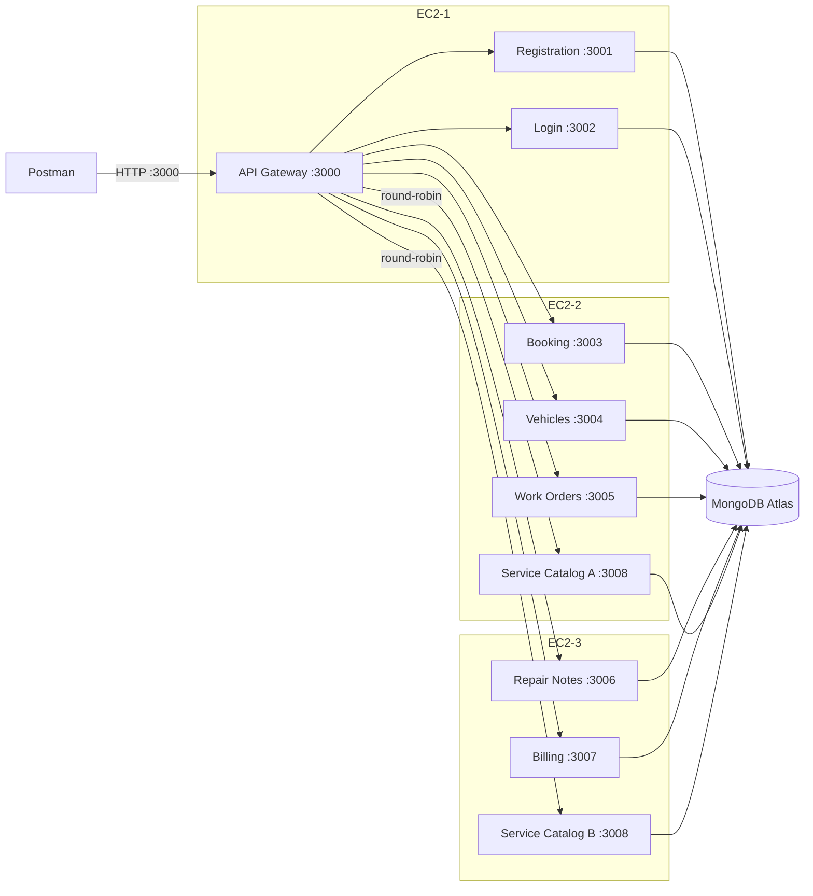

# Car Repair Shop Management System (CLD 376)

The backend for a car repair shop. Customers register their cars, book repairs, follow the repair's progress and see what they owe. Mechanics see the jobs assigned to them and write notes on what they found and fixed. The manager (shop owner) controls everything: approves bookings, assigns mechanics, sets prices and bills customers.

- **Backend only:** you use it through an API, for example with Postman. There is no website or app.
- **9 microservices** written in Node.js (Express 5, Mongoose 8), each in its own Docker container.
- **3 AWS EC2 instances**, with one API Gateway as the only public entry point.
- **MongoDB Atlas**, with a separate database for each service.
- **JWT login** with 3 roles: customer, mechanic and manager.

## Contents

1. [Architecture](#architecture)
2. [Roles and permissions](#roles-and-permissions)
3. [How one request works](#how-one-request-works)
4. [The repair flow](#the-repair-flow)
5. [API endpoints](#api-endpoints)
6. [Security](#security)
7. [Load balancer](#load-balancer)
8. [Data design](#data-design)
9. [Run it locally](#run-it-locally)
10. [Deploy to EC2](#deploy-to-ec2)
11. [Testing with Postman](#testing-with-postman)
12. [Project structure](#project-structure)
13. [Conventions](#conventions)
14. [Known limitations](#known-limitations)
15. [Team](#team)
16. [Next: Kubernetes](#next-kubernetes)
17. [AI usage](#ai-usage)

## Architecture

Every request enters through the API Gateway on EC2-1, port 3000. The gateway checks the login token and then forwards the request to the right service, using the instances' private IPs. Each service talks only to its own database.



| Service | Owner | EC2 | Port | Gateway path | Database |
| --- | --- | --- | --- | --- | --- |
| api-gateway | Member 1 | EC2-1 | 3000 | entry point for everything | none |
| registration | Member 2 | EC2-1 | 3001 | `/api/auth/register`, `/api/users` | `auth_db` |
| login | Member 3 | EC2-1 | 3002 | `/api/auth/login`, `/api/auth/me`, `/api/auth/verify` | `auth_db` (read only) |
| booking | Member 1 | EC2-2 | 3003 | `/api/bookings` | `bookings_db` |
| vehicles | Member 1 | EC2-2 | 3004 | `/api/vehicles` | `vehicles_db` |
| work-orders | Member 2 | EC2-2 | 3005 | `/api/work-orders` | `workorders_db` |
| repair-notes | Member 2 | EC2-3 | 3006 | `/api/notes` | `notes_db` |
| billing | Member 3 | EC2-3 | 3007 | `/api/invoices` | `billing_db` |
| service-catalog (2 copies) | Member 3 | EC2-2 and EC2-3 | 3008 | `/api/catalog` | `catalog_db` |

Only port 3000 on EC2-1 is open to the internet. The other services can be reached only from inside the VPC, so nobody can go around the gateway.

## Roles and permissions

| Role | Who | How the account is made |
| --- | --- | --- |
| Customer | A car owner | Signs up themselves with `POST /api/auth/register` |
| Mechanic | Shop staff | Created by a manager |
| Manager | The shop owner | The first one comes from the seed script; others are created by a manager |

| What | Customer | Mechanic | Manager |
| --- | --- | --- | --- |
| Users | Sign up, see own profile | See own profile | Create staff, list users |
| Vehicles | Full control of own cars | Read all | Read, update, delete |
| Service Catalog | Read (no login needed) | Read | Full control |
| Bookings | Create, read and cancel own (while pending) | None | Read all, approve or reject, delete |
| Work Orders | Read own (to follow the repair) | Read assigned ones, update status | Full control; create and assign |
| Repair Notes | None | Add notes; edit and delete own | Read, delete |
| Invoices | Read own | None | Full control; create, mark paid |

Every request is checked twice:

1. **The gateway checks the role:** "can a customer ever do this?"
2. **The service checks the owner:** "is this your car, your booking, your invoice?"

The gateway can't do the second check, because it doesn't know who owns which record. A failed owner check returns 403. List endpoints don't fail: they quietly show only your own records.

## How one request works

1. Postman sends the request to the gateway with `Authorization: Bearer <token>`.
2. The gateway checks that the token is real and not expired. If not, it returns **401**.
3. The gateway looks up the method and path in `policy.js`. If the role isn't allowed, or the route isn't listed at all, it returns **403**.
4. The gateway removes any `x-user-id` and `x-user-role` headers the client sent, sets them again from the token, and forwards the request.
5. The service reads those two headers, checks ownership, and reads or writes its own database. The answer goes back through the gateway unchanged.

## The repair flow

One repair uses all 9 services. This is also the demo order.

1. A customer registers, logs in and gets a token.
2. The customer looks at the price list (no login needed) and adds their car.
3. The customer books a repair. Booking asks Vehicles to confirm the car is really theirs.
4. The manager approves the booking.
5. The manager turns the booking into a work order and assigns a mechanic. Work Orders reads the booking and copies the customer and car.
6. The mechanic sets the work order to `in_progress` and adds a "finding" note.
7. The mechanic adds a "work done" note and sets the work order to `completed`.
8. The customer checks the work order to see that the repair is done.
9. The manager creates the invoice. Billing confirms the work order is completed, and the server adds up the total.
10. The customer sees the invoice, and the manager marks it paid.

## API endpoints

All paths go through the gateway (`http://<host>:3000`). **Public** means no token is needed. "Own" and "assigned" are checked by the service.

### Registration (port 3001)

| Method | Path | Who | Notes |
| --- | --- | --- | --- |
| POST | `/api/auth/register` | Public | Always creates a customer, whatever `role` the body says |
| POST | `/api/users/staff` | Manager | Creates a mechanic or manager |
| GET | `/api/users` | Manager | `?role=mechanic` lists mechanics to assign |

### Login (port 3002)

| Method | Path | Who | Notes |
| --- | --- | --- | --- |
| POST | `/api/auth/login` | Public | Returns `{ token, expiresIn, user }` |
| GET | `/api/auth/me` | Any role | Your own profile |
| GET | `/api/auth/verify` | Any role | Shows what's inside your token |

### Vehicles (port 3004)

| Method | Path | Who | Notes |
| --- | --- | --- | --- |
| POST | `/api/vehicles` | Customer | The owner is always the logged-in customer |
| GET | `/api/vehicles` | All roles | Customers see only their own cars |
| GET | `/api/vehicles/:id` | Own customer, mechanic, manager | |
| PUT | `/api/vehicles/:id` | Own customer, manager | Any field except the owner |
| DELETE | `/api/vehicles/:id` | Own customer, manager | |

### Booking (port 3003)

| Method | Path | Who | Notes |
| --- | --- | --- | --- |
| POST | `/api/bookings` | Customer | Checks the car is yours; the date must be in the future |
| GET | `/api/bookings` | Customer, manager | Customers see their own; managers can add `?status=pending` |
| GET | `/api/bookings/:id` | Own customer, manager | |
| PATCH | `/api/bookings/:id/status` | Own customer, manager | Only while pending. Customer: `cancelled`. Manager: `approved` or `rejected` |
| DELETE | `/api/bookings/:id` | Manager | |

### Work Orders (port 3005)

| Method | Path | Who | Notes |
| --- | --- | --- | --- |
| POST | `/api/work-orders` | Manager | Body: `bookingId`, `mechanicId`. The booking must be approved |
| GET | `/api/work-orders` | All roles | Customers see theirs, mechanics see the ones assigned to them |
| GET | `/api/work-orders/:id` | Own customer, assigned mechanic, manager | |
| PATCH | `/api/work-orders/:id/status` | Assigned mechanic, manager | `assigned`, `in_progress` or `completed` |
| DELETE | `/api/work-orders/:id` | Manager | |

### Repair Notes (port 3006)

| Method | Path | Who | Notes |
| --- | --- | --- | --- |
| POST | `/api/notes` | Mechanic | Body: `workOrderId`, `type` (`finding` or `work_done`), `text` |
| GET | `/api/notes?workOrderId=` | Mechanic, manager | `workOrderId` is required |
| GET | `/api/notes/:id` | Mechanic, manager | |
| PUT | `/api/notes/:id` | The note's author | Only `type` and `text` can change |
| DELETE | `/api/notes/:id` | The note's author, manager | |

### Billing (port 3007)

| Method | Path | Who | Notes |
| --- | --- | --- | --- |
| POST | `/api/invoices` | Manager | Body: `workOrderId`, `lineItems`. The work order must be completed; the server works out the total |
| GET | `/api/invoices` | Customer, manager | Customers see their own; managers can add `?status=unpaid` |
| GET | `/api/invoices/:id` | Own customer, manager | |
| PATCH | `/api/invoices/:id/pay` | Manager | Body: `paymentMethod` (`cash`, `bank_transfer` or `card`) |
| DELETE | `/api/invoices/:id` | Manager | Only while unpaid |

### Service Catalog (port 3008, 2 copies)

| Method | Path | Who | Notes |
| --- | --- | --- | --- |
| GET | `/api/catalog` | Public | The price list; `?active=true` hides inactive services |
| GET | `/api/catalog/:id` | Public | |
| POST | `/api/catalog` | Manager | |
| PUT | `/api/catalog/:id` | Manager | |
| DELETE | `/api/catalog/:id` | Manager | |
| GET | `/api/catalog/health` | Public | Shows which copy answered (for the load balancer demo) |

Every service also has `GET /health`, which Docker uses to mark the container as healthy.

## Security

- **Login tokens (JWT):** Login signs a token with HS256 that lasts 1 hour and holds the user's id, role and name. Only the gateway checks tokens. The algorithm is fixed, so a forged "unsigned" token is rejected.
- **Deny by default:** every endpoint must have a row in `services/api-gateway/src/policy.js`. Anything not listed is blocked with 403, so a forgotten row closes access instead of opening it.
- **No fake identities:** the gateway always deletes `x-user-id` and `x-user-role` sent by the client before setting them from the token.
- **Ownership checks:** services take the owner from the headers, never from the request body. A customer can't sign up as a manager, put someone else's id on a car, or set an invoice total.
- **Passwords:** hashed with bcrypt (cost 10) and never returned in any response.
- **One login error:** a wrong email and a wrong password both give "Invalid email or password", so nobody can find out which emails are registered.
- **Secrets stay out of git:** `MONGO_URI` and `JWT_SECRET` live only in gitignored `.env` files. Only `.env.example` files with placeholders are committed.

## Load balancer

The Service Catalog runs as 2 copies: catalog-a on EC2-2 and catalog-b on EC2-3. Both use the same database. The gateway sends catalog requests to them in turn: A, B, A, B. The code is a few lines in `services/api-gateway/src/loadBalancer.js`.

To see it, send `GET /api/catalog/health` 4 times. The `instance` field alternates between `catalog-a` and `catalog-b`.

## Data design

- **One database per service.** Services never read each other's data directly; they ask each other through the API. A change in one service's data can't silently break another.
- **Copied ids.** Some records copy an id when they are created: `customerId` and `vehicleId` on work orders, and `customerId` on invoices. That way each service can show "only your records" without calling another service.
- **Only 3 calls between services, all through the gateway with the caller's own token:**
  - Booking → Vehicles: is it your car?
  - Work Orders → Booking: is it approved?
  - Billing → Work Orders: is it completed?

  Each call waits up to 5 seconds, then fails with 502.
- **Unique indexes** stop duplicates even when two requests arrive at the same moment: one email per user, one plate per car, one catalog name, one work order per booking, and one invoice per work order.
- **Money is whole cents** (`2500` = $25.00), so totals never drift by fractions of a cent.

### CRUD coverage

| Database | Create | Read | Update | Delete |
| --- | --- | --- | --- | --- |
| vehicles | ✓ | ✓ | ✓ | ✓ |
| bookings | ✓ | ✓ | ✓ (status) | ✓ |
| work orders | ✓ | ✓ | ✓ (status) | ✓ |
| repair notes | ✓ | ✓ | ✓ | ✓ |
| invoices | ✓ | ✓ | ✓ (mark paid) | ✓ |
| catalog | ✓ | ✓ | ✓ | ✓ |
| users | ✓ | ✓ | – | – |

All six domain services have full create, read, update and delete. User accounts belong to the two login services: Registration creates them and Login only reads them. User update and delete were left out on purpose. Deleting an account would leave its bookings, work orders and invoices pointing at a user that no longer exists. A real system would deactivate accounts instead.

## Run it locally

You need Docker, Node.js 24 and the team's Atlas details.

1. **Settings:** copy `.env.example` to `.env` in the repo root and fill in `ATLAS_USER`, `ATLAS_PASSWORD`, `ATLAS_HOST` and `JWT_SECRET`. A new secret can be made with:

   ```bash
   node -e "console.log(require('crypto').randomBytes(32).toString('hex'))"
   ```

2. **Start all 9 services:**

   ```bash
   docker compose -f docker-compose.dev.yml up --build
   ```

   The gateway is then at `http://localhost:3000`. Catalog copy B uses port 3009 on your laptop, because one machine can't use 3008 twice.
3. **Add test data** (once):

   ```bash
   npm ci                                  # in the repo root
   cp scripts/.env.example scripts/.env    # fill in the two Atlas URIs
   npm run seed:users
   npm run seed:catalog
   ```

Test logins created by the seed script. The password for all of them is `Test1234!`.

| Role | Email |
| --- | --- |
| Manager | `manager@shop.test` |
| Mechanic | `mechanic1@shop.test`, `mechanic2@shop.test` |
| Customer | `customer1@shop.test`, `customer2@shop.test` |

### Run one service on its own

Useful while working on a single service:

```bash
cd services/vehicles
npm ci
cp .env.example .env        # fill in MONGO_URI
npm run dev                 # restarts on every save
```

Without the gateway, pretend to be it by sending the two identity headers yourself:

```bash
curl localhost:3004/api/vehicles -H "x-user-id: 66f1c2a9e4b0a1b2c3d4e5f6" -H "x-user-role: customer"
```

## Deploy to EC2

The 3 instances run in one AWS Learner Lab, in the same VPC. Each instance has its own compose file in `deploy/ec2-1`, `deploy/ec2-2` and `deploy/ec2-3`. On each one, the steps are: clone the repo, create the `env/` files from `env.example/`, then run `docker compose up -d --build`.

The full steps are in [deploy/README.md](deploy/README.md).

## Testing with Postman

The `postman/` folder has 2 collections. In Postman, click **Import** and pick a file.

| Collection | Covers |
| --- | --- |
| `member-1.postman_collection.json` | Logins, gateway checks, vehicles, bookings, cleanup |
| `member-2.postman_collection.json` | Registration, work orders, repair notes, negative tests |

Set the `gateway` variable to `http://localhost:3000` for local testing, or `http://<EC2-1 public IP>:3000` for EC2. Run the login requests first and copy the tokens into the token variables. Each request's description says what result to expect.

## Project structure

```text
.
├── services/
│   ├── api-gateway/        # token check, policy.js, proxying, loadBalancer.js
│   ├── registration/
│   ├── login/
│   ├── booking/
│   ├── vehicles/
│   ├── work-orders/
│   ├── repair-notes/
│   ├── billing/
│   └── service-catalog/
│       ├── src/
│       │   ├── index.js            # app setup, /health, error handler, database connection
│       │   ├── routes.js           # the endpoints
│       │   ├── model.js            # the Mongoose schema
│       │   └── middleware/user.js  # reads x-user-id / x-user-role (same file in every service)
│       ├── Dockerfile              # same in every service except the port
│       ├── .dockerignore
│       ├── .env.example
│       └── package.json
├── deploy/                 # one compose file per EC2 + setup guide
├── scripts/                # seed-users.js, seed-catalog.js
├── postman/                # Postman collections
├── docker-compose.dev.yml  # all 9 services on one laptop
└── .env.example            # settings for docker-compose.dev.yml
```

## Conventions

All 9 services follow the same rules, so they look and behave alike.

- **Same libraries:** Express 5 and Mongoose 8, plus `bcryptjs` and `jsonwebtoken` only where needed. Built-in `fetch` for calls between services; no `axios` or `dotenv`.
- **Same Dockerfile:** small `node:24-alpine` image, exact versions from the lockfile, runs as a normal user (not root), with a health check.
- **Same responses:**
  - a single record comes back as the document, with `_id`
  - a list is a plain array
  - create returns 201, delete returns 204 with no body
  - dates are ISO 8601 in UTC
- **Same error shape** everywhere: `{ "error": { "code": "FORBIDDEN", "message": "..." } }`

| Code | Status | Meaning |
| --- | --- | --- |
| `VALIDATION_ERROR` | 400 | A field is missing or wrong |
| `VEHICLE_NOT_OWNED` | 400 | Booking a car that isn't yours |
| `BOOKING_NOT_APPROVED` | 400 | Work order for a booking that isn't approved |
| `WORK_ORDER_NOT_COMPLETED` | 400 | Invoice for a repair that isn't finished |
| `NO_TOKEN` | 401 | No login token sent |
| `INVALID_TOKEN` | 401 | The token is fake, changed or expired |
| `INVALID_CREDENTIALS` | 401 | Wrong email or password |
| `FORBIDDEN` | 403 | Wrong role, or not your record |
| `NOT_FOUND` | 404 | No such record |
| `DUPLICATE` | 409 | Already exists (email, plate, catalog name, work order, invoice) |
| `UPSTREAM_UNAVAILABLE` | 502 | A service this request needs is down or too slow |
| `INTERNAL_ERROR` | 500 | Something unexpected; details go to the log only |

**Git workflow:** each member edits only their own services, works on a branch and opens a pull request into `main`. Commit messages follow [Conventional Commits](https://www.conventionalcommits.org/) (`feat(vehicles): ...`).

## Known limitations

These are known shortcuts, each with what the stronger version would be:

| Shortcut | Stronger version |
| --- | --- |
| Tokens are signed with one shared secret (HS256) | RS256, where only Login can sign |
| No refresh tokens or logout | Users log in again after 1 hour |
| Services trust the gateway's identity headers | Each service checks the token again |
| Docker images are built on the servers | Images are pushed to a registry and servers only pull them |
| Work Orders doesn't check that `mechanicId` is a real mechanic | Ask Registration to confirm the user is a mechanic |
| Atlas accepts connections from any IP, with one database user for all services | Allow only the EC2 IPs, and give each service its own database user |
| No user update or delete | See [CRUD coverage](#crud-coverage) |

## Team

| Member | Side of the shop | Services | Other duties |
| --- | --- | --- | --- |
| Member 1 (Soxavin) | Customer | API Gateway, Booking, Vehicles | Repo setup, gateway policy, load balancer |
| Member 2 (Laimeng) | Mechanic | Registration, Work Orders, Repair Notes | Atlas, JWT secret, seed scripts, submission document |
| Member 3 (Pissoth) | Shop owner | Login, Billing, Service Catalog | EC2 instances, compose files, deployment |

## Next: Kubernetes

The final project reuses the same images:

- Each service becomes a Kubernetes Deployment.
- The `.env` files become ConfigMaps and Secrets.
- The gateway's round-robin is replaced by a Service with 2 replicas.

No service code should need to change.

## AI usage

This project was built with AI assistance, which the course permits. We used Claude (Anthropic) to help plan the architecture and draft the PRD, and Claude Code to generate and debug service code from that spec. The team made the design decisions, reviewed every change, and tested all endpoints in Postman. Each member can explain their own services without notes.
